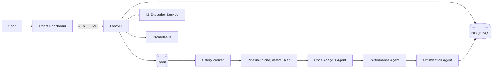

# ScaleAI

**AI-powered repository scalability analysis, performance-test planning, and optimization recommendations.**

Paste a public GitHub repo and a target user count. ScalePilot AI detects the tech stack, scans the code for scalability risks, and runs three coordinated AI agents that explain the findings, plan a k6 load test, and propose developer-reviewed fixes.

> **Note:** Static analysis and AI recommendations are not measured performance. A performance plan is a proposal until the load-test endpoint runs it and records real k6 metrics.

## Key Features

- **Repository analysis:** shallow clone of public GitHub repos into a temporary workspace
- **Stack detection:** languages, frameworks, databases, ORMs, caches, queues and endpoints
- **Static scanning:** Tree-sitter and Semgrep rules find N+1 queries, blocking calls, missing caching, unbounded queries and more
- **Three AI agents:** Code Analysis, Performance Testing and Optimization (Groq and LangGraph)
- **k6 test generation:** scenarios, virtual-user targets and thresholds
- **Controlled load-test execution:** scripts are validated and targets restricted to a local allowlist
- **Human-approved patches:** optimizations are never applied automatically
- **Report Q&A:** ask follow-up questions about any report
- **Dashboard:** live progress, findings, architecture and performance views
- **Resilient jobs:** Celery and Redis, with a background-thread fallback

## How It Works



1. The user signs in and submits a GitHub URL, target users and a model.
2. The backend creates a report and queues the job.
3. The repo is cloned, profiled and scanned.
4. The three agents run in sequence through LangGraph.
5. The results are saved, and the dashboard polls for progress.
6. Optionally, the user runs the generated k6 test against an authorized local target.

## The Three Agents

| Agent | Job |
|---|---|
| **Code Analysis** | Enriches scanner findings with root cause, impact, evidence and a 0-100 health score |
| **Performance Testing** | Recommends scenarios (smoke, load, stress, spike, soak) and generates k6 scripts |
| **Optimization** | Correlates findings and proposes minimal patches that require developer approval |

Each agent runs in its own error boundary, so one failure does not stop the report.

## Tech Stack

- **Frontend:** React 18, Vite, Tailwind CSS, Framer Motion, Recharts
- **Backend:** Python, FastAPI, Pydantic, SQLAlchemy, PostgreSQL
- **Jobs:** Celery, Redis
- **AI:** Groq API, LangGraph
- **Analysis:** Tree-sitter, Semgrep
- **Load testing:** k6
- **DevOps:** Docker Compose, Nginx, Prometheus, Pytest

## Quick Start (Docker)

```bash
cp .env.example .env     # add your GROQ_API_KEY
docker compose up --build
```

| Service | URL |
|---|---|
| Frontend | http://localhost:5173 |
| API docs | http://localhost:8000/docs |
| Health | http://localhost:8000/health |
| Groq check | http://localhost:8000/health/groq |
| Prometheus | http://localhost:9090 |

Demo login: `demo@scalepilot.ai` / `demo1234`

Useful commands: `make up`, `make down`, `make logs`, `make test`, `make fe`

## API Overview

| Method | Endpoint | Description |
|---|---|---|
| POST | `/api/auth/signup`, `/login`, `/demo` | Authenticate and get a JWT |
| GET | `/api/auth/me` | Current user |
| POST | `/api/analyses` | Create an analysis (returns 202) |
| GET | `/api/analyses` | List your reports |
| GET | `/api/analyses/{id}` | Report status and results |
| POST | `/api/analyses/{id}/load-test` | Run the generated k6 script |
| POST | `/api/analyses/{id}/ask` | Ask a question about a report |

```bash
curl -X POST http://localhost:8000/api/analyses \
  -H "Authorization: Bearer YOUR_JWT_TOKEN" \
  -H "Content-Type: application/json" \
  -d '{"repo_url": "https://github.com/owner/repo", "target_users": 100, "model": "your-selected-model"}'
```

## Security Safeguards

- JWT authentication with single active session per account
- Scrypt-hashed passwords
- GitHub URLs validated; repo size, file count and clone time limited
- Secrets redacted before code is sent to the AI
- k6 scripts checked for dangerous JavaScript; targets restricted to a local allowlist; execution timeouts enforced
- Patches are recommendations only and are never auto-applied

## Testing

```bash
cd backend && python -m pytest -q
cd frontend && npm install && npm run build
```

## Limitations and Next Steps

- Public GitHub repos only (no private repo auth yet)
- Tree-sitter covers Python, JavaScript and TypeScript; Semgrep covers selected other languages
- Load tests are limited to local or allowlisted hosts
- Planned: Alembic migrations, PR auto-generation, more languages, continuous monitoring
