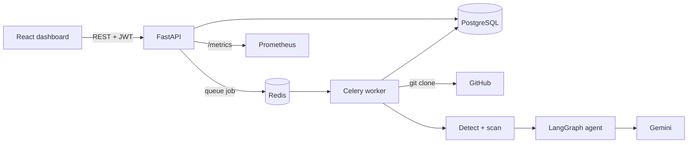

# Architecture

## Layers (backend/app)
| Layer | Files | Job |
|---|---|---|
| API | `main.py`, `routers/` | HTTP, validation, auth, one running job per user |
| Domain | `models.py`, `schemas.py` | Users, repositories, reports |
| Orchestration | `pipeline.py`, `worker.py`, `celery_app.py` | Runs the stages and records progress |
| Services | `services/` | `git_ops` clone, `fsutil` safe file loading, `detect` stack, `scanner` issues, `ai_agent` Gemini |
| Rules | `rules/scalability.yml` | Semgrep rules for Java, Go, PHP, Ruby |

## Frontend (frontend/src)
`pages/` screens, `components/` UI (`ui/` is shadcn-style), `context/` auth and theme, `lib/api.js` the only place that calls the backend.

## API
| Method | Path | Notes |
|---|---|---|
| POST | `/api/auth/signup`, `/login`, `/demo` | Returns a JWT. Each login replaces the previous session for that email. |
| GET | `/api/auth/me` | Also used to detect a replaced session |
| POST | `/api/auth/logout` | |
| POST | `/api/analyses` | `{repo_url, target_users, model}` returns 202 and a report id |
| GET | `/api/analyses/{id}` | Status, stage, architecture, findings, summary |
| GET | `/api/analyses` | Your last 50 reports |

## Next phase hooks
- Load tests: add a `load_test` stage in `pipeline.py` and store `{curve: [...]}` in a new `Report.load_test` column. The charts already read `report.load_test.curve`.
- Fine-tuned models: edit `MODEL_MAP` in `services/ai_agent.py`.
- Sandboxed runs with Docker SDK and k6 belong in a new `services/sandbox.py` called from the pipeline.
